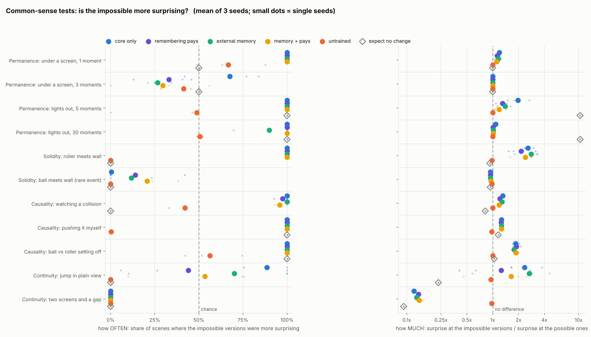
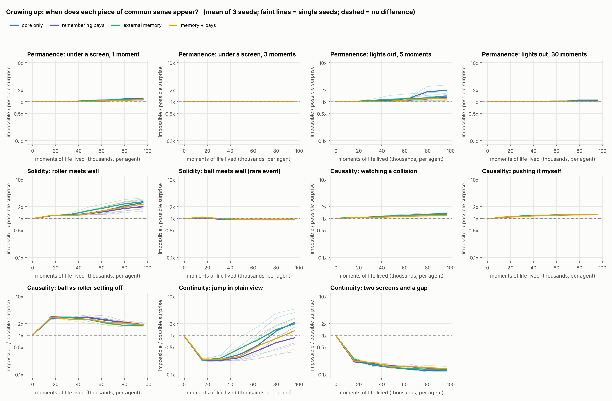

# BU-EAI — Bottom-Up Emergent AI

A working prototype of the BU-EAI thesis: instead of training a model top-down
on a static dataset, grow a mind from accumulated simulated experience.

An agent wanders a small 2D world with three senses. Its brain is built from
separate sensory regions that feed a shared recurrent core, and the core feeds
back into the regions. It has **no language, no reward, no labels and no
goal**. The only thing it ever learns is to predict what it will sense next.

Afterwards we freeze it and ask: did it work out things nobody told it?

| Version | Question | Short answer |
|---|---|---|
| **v0.3** (current) | In a world where things move, hide and react, does basic common sense about objects appear, tested the way babies are tested? Does a memory help? | **Partly.** It is surprised when a roller goes through a wall, when a roller jumps, and when a lifeless ball moves by itself. It has **nothing** about things it cannot see: it expects whatever goes under a screen to be gone. Adding memory did not help. |
| v0.2 (tag `v0.2`) | Dropped into a place it has never seen, does it build a map within one life? | It finds **where it is** (error 4.55 to 1.19 cells in 400 moments). It does not remember **what is where**. |
| v0.1 (tag `v0.1`) | In one fixed world, does a sense of position emerge from prediction alone? | Yes: 0.40 cells in the dark, against 1.35 untrained. But that map was memorised in the weights. |

All numbers, tables, the things that did not work, and the reasoning behind
each choice are in **[RESULTS.md](RESULTS.md)**.

## Run it

```bash
pip install -r requirements.txt
```

The v0.3 experiment (12 brains: 4 memory conditions x 3 seeds; about 2 hours on
4 CPU cores):

```bash
python run_v03.py
```

Run every test again on the saved brains, with no training (a few minutes):

```bash
python run_v03.py --retest
```

Carry on after an interruption (gives the same result as an uninterrupted run):

```bash
python run_v03.py --resume
```

A 2-minute smoke test (its numbers mean nothing):

```bash
python run_v03.py --quick
```

Reprint the report and redraw the figures from saved results:

```bash
python run_v03.py --report-only
```

Check whether the brains with an external memory use it:

```bash
python memory_check.py
```

Earlier versions still run and still give their original numbers:

```bash
python run_v02.py
```

```bash
python run_experiment.py
```

Unit tests for the building blocks (43, about 15 seconds):

```bash
python -m pytest tests/ -q
```

Everything is deterministic: the same seeds give the same numbers. Outputs go
to `results/v0.3/`, `results/v0.2/` and `results/v0.1/`.

## The files

| File | What it is | Brain analogy |
|---|---|---|
| `bueai/lively_world.py` | v0.3 world: balls, rollers, screens, physics | A world where things move, hide and react |
| `bueai/model_v03.py` | v0.3 brain: vision region with its own short-term memory, core, optional episodic store | Retinotopic visual cortex, association area, hippocampus |
| `bueai/commonsense_test.py` | The violation-of-expectation tests | A psychologist testing a baby |
| `bueai/memory_test.py` | "What is where" probes in the v0.3 world | A neuroscientist recording in a new maze |
| `bueai/checkpoints.py` | Save and load trained brains with their recipe | |
| `bueai/training.py` | `Life` (the loop of experience) and `train()` | Living, and learning from surprise |
| `bueai/model.py` | v0.1/v0.2 brain: regions, core, top-down feedback, curiosity heads | Sensory cortex areas, association area |
| `bueai/world.py`, `bueai/many_worlds.py`, `bueai/senses.py` | v0.1 and v0.2 worlds and the sense organs | The outside world; eye, skin, ear |
| `bueai/newmap_test.py`, `bueai/emergence_test.py`, `bueai/darkroom_test.py` | v0.2 and v0.1 tests | |
| `bueai/plots*.py` | The figures | |
| `run_v03.py`, `memory_check.py` | Run v0.3; check the external memory | |
| `run_v02.py`, `tv_check.py`, `run_experiment.py` | Run v0.2 and v0.1 | |
| `tests/` | Unit tests | |

## The world (v0.3)

A new random 16x16 map for every life. One example ('@' is the agent):

```
################        #  wall        grey,   feels rough
#..#@......###.#        .  floor
#S.............#        B  bell        red,    smooth, high pitch
#.....r........#        F  fountain    blue,   wet,    mid pitch
#........SSS...#        m  moss        green,  soft,   low pitch
#..............#        S  screen      cream,  cloth.  Covered floor: balls and rollers
#..............#                       pass underneath unseen. The agent cannot enter.
#.....SS.......#        o  ball        yellow, hard.   Lifeless: moves only when pushed,
#...######..o..#                       then rolls until something stops it.
#.......##....m#        r  roller      magenta, furry. Moves by itself: straight lines,
##......##B....#                       turns when blocked, rests, sets off again.
##......##.....#
##.......#..m.r#
##.............#
##m...F....oS..#
################
```

The senses are as before: **vision** (a 5x5 patch of colours around the agent),
**touch** (the texture under the agent and on its four sides) and **hearing**
(loudness of three pitches, no direction). Balls and rollers are silent.
Actions are stay / north / east / south / west, chosen by a random walk with
some momentum. Walking into a ball pushes it.

## The brain (v0.3)

```
                +----------------------------------------------+
                |        top-down feedback (previous state)    |
                v                                              |
vision  --> [vision region:         ] --+                      |
            [5x5 map with its own   ]   |                      |
            [short-term memory      ] --|----------------------|--> [local predictor] --+
touch   --> [touch region  ] -----------+--> [ recurrent core ]+--> [predictors] -------+--> next vision
hearing --> [hearing region] -----------+      ^     ^    |                             --> next touch
                                 last action --+     |    +--- + action ------------^   --> next hearing
                                                     |    |
                                       [episodic store]<--+   (optional: write a moment, look moments up)
```

One moment of experience, as coded in `Life.live()`:

1. **Sense.** Each sense organ reports its numbers.
2. **Update the mind.** Each region encodes its sense together with top-down feedback from the core. The core combines them with its own memory and the last action.
3. **Act.** A random move.
4. **Predict.** From the mind state and the chosen action, guess the next sensation.
5. **Compare.** The squared difference between guess and reality is the prediction error: the only learning signal, and in the tests the brain's "surprise meter".

### Design change in v0.3: sensory regions have a short memory of their own

The v0.2 brain could not learn how things move. Watching a roller cross open
floor, it bet about 40% on "it stays where it is" and had no sense of
direction, after 190,000 moments of life. Its vision region squeezed each
image into 32 numbers and forgot it; only the core remembered anything.

In v0.3 the vision region keeps its own 5x5 map of recent activity (one small
vector per cell of the view), updated by the same small set of weights at
every cell. A second, local predictor reads that map directly. "It was one
cell to the left, so next it is one cell to the right" is then learned once
and holds at all 25 cells.

This changes the thesis design, not just a setting. **Before, only the core
had memory; now a sensory region has a short one too.** It resembles early
visual cortex (laid out like the retina, sensitive to motion, holding a brief
trace of what was just seen). It also builds in something the old brain was
not given: the assumption that the same rules hold everywhere in the view.
The full story of how the problem was found is in [RESULTS.md](RESULTS.md).

### The memory conditions

| Condition | What it is |
|---|---|
| **Core only** | The v0.3 brain as above, nothing added. |
| **Remembering pays** | The same brain, raised with darkness half the time and lives twice as long in each map. |
| **External memory** | The brain plus a hippocampus-like store: it files away what it sensed every 4 moments, and every moment asks the store "what did I sense when things were like this?" Only the asking is learned. |
| **Both** | The store, in the world where remembering pays. |

## The common-sense tests

A baby cannot say what it expects, but it looks longer at things that surprise
it. Our brain's surprise is its prediction error. Each test stages a short
scene in versions that are possible and versions that are impossible, and
compares the surprise. The versions are identical until the event; impossible
ones break exactly one rule.

| Principle | Possible | Impossible |
|---|---|---|
| **Object permanence** | a roller goes under a screen and comes out | it never comes out; or one comes out that never went in |
| **Solidity** | a roller turns away at a wall | it goes through the wall |
| **Causality** | a ball moves when pushed (by a roller, or by the agent itself) | it moves untouched; or does not move when pushed |
| **Continuity** | a roller crosses the gap between two screens | it skips the gap; or jumps to a far cell in plain view |

Each test reports two numbers: how **often** the impossible versions were the
more surprising ones (50% is chance), and by how **much** (1.0x is no
difference). Both are compared with the same network untrained and with a
brain-free "expect no change" rule.

## v0.3 results in brief

Full tables are in [RESULTS.md](RESULTS.md). 12 brains: 4 conditions x 3 seeds.



**What appeared** (in every one of the 12 brains unless noted):

- **Solidity for rollers.** A roller going through a wall is 2.1 to 2.8 times as surprising. Untrained: no difference.
- **Lifeless vs self-moving.** A ball setting off by itself is 1.8 to 1.9 times as surprising as a roller doing so.
- **Continuity in plain view**, in 8 of 12 brains. The other 4 had not learned roller motion yet when training stopped.
- **Short-gap permanence, weakly.** 1.2 to 2.0x after 5 dark moments; 1.1 to 1.2x after one moment under a screen.
- **Half of "I can push things".** Surprised when a pushed ball does not budge, but still surprised when its own push works.

**What did not appear:**

- **Anything about hidden things.** Three moments under a screen, 30 dark moments: no effect.
- **The two-screens test came out backwards in all 12 brains.** The brain is 8 times MORE surprised when the roller comes out into the gap than when it skips it. In its predictions, whatever goes under a screen is gone. What it has learned about screens is "things vanish here": true of what it sees, false of the world.
- **Ball physics.** It expects a rolling ball to stop. Balls roll in under 1% of moments.

### Memory did not help, and a lead that was only a head start

No memory condition beat the plain brain on any test. The differences between
seeds inside one condition are bigger than the differences between conditions.



An early one-seed pilot seemed to show the external store well ahead. It
turned out those brains had simply learned roller motion earlier in training.
Once the plain brain's visual memory was restored to its validated size, it
caught up and the lead was gone. When motion "clicks" varies from seed to seed
by more than any condition changes it, so a one-seed comparison at one moment
in training would have reported a memory effect that was a head start.

The store is used: emptying it at test time makes vision predictions 5 to 13%
worse and hearing predictions 15 to 44% worse (`memory_check.py`). It seems to
supply a sense of "what this place is like". It does not supply "that roller
is still under there".

## Saved brains

Every trained brain is saved with the recipe to rebuild it
(details: [results/CHECKPOINTS.md](results/CHECKPOINTS.md)):

```python
from bueai.checkpoints import load_brain
brain, info = load_brain("results/v0.3/checkpoints/core_seed0.pt")
print(info["nickname"], "-", info["note"])
```

The twelve v0.3 brains, each trained for 3,000 updates (96,000 moments per agent):

| Nickname | Condition | Seed | File in `results/v0.3/checkpoints/` |
|---|---|---|---|
| Sachiel | Core only | 0 | `core_seed0.pt` |
| Shamshel | Core only | 1 | `core_seed1.pt` |
| Ramiel | Core only | 2 | `core_seed2.pt` |
| Gaghiel | Remembering pays | 0 | `pays_seed0.pt` |
| Israfel | Remembering pays | 1 | `pays_seed1.pt` |
| Sandalphon | Remembering pays | 2 | `pays_seed2.pt` |
| Matarael | External memory | 0 | `memory_seed0.pt` |
| Sahaquiel | External memory | 1 | `memory_seed1.pt` |
| Iruel | External memory | 2 | `memory_seed2.pt` |
| Leliel | Both | 0 | `both_seed0.pt` |
| Bardiel | Both | 1 | `both_seed1.pt` |
| Zeruel | Both | 2 | `both_seed2.pt` |

Also saved: seven pilot brains in `results/v0.3/checkpoints/pilot/` (including
`watcher.pt`, the positive control that showed the tests can be passed) and
the twelve v0.2 brains in `results/v0.2/checkpoints/`.

## What these results do not show

- **Training was cut short.** Every brain was still improving at 3,000 updates.
- **Three seeds, and seeds matter a lot here.** Enough for what all 12 brains share; not enough to rank the memory conditions.
- **The new vision region builds in an assumption** (the same rules everywhere in the view) that the motion results depend on.
- **Some tests can be partly passed by the raw amount of change on screen**; RESULTS.md marks which.
- **A toy world.** One object is one cell. Nothing here is comparable with benchmark numbers from 3D video (PLATO, IntPhys, V-JEPA). What is different about this project is that the agent acts, has several senses, and that memory is the thing being varied.

## Options for v0.4

Every brain was still improving, so the cheapest next step is more training,
and the saved brains can simply carry on.

| Plan | Time on 4 cores |
|---|---|
| Continue all 12 saved brains by 3,000 updates (to 6,000) | about 1 h 40 min |
| Start 12 fresh brains and train to 6,000 | about 3 h 20 min |
| Continue all 12 by 6,000 updates (to 9,000) | about 3 h 20 min |
| Start 12 fresh brains and train to 9,000 | about 5 h |

Continuing saves the time already spent. It is not identical to one long run
(the optimiser's running averages and the lives in progress start afresh), and
it only works while the brain's shape and the senses stay the same. Changing
the world is fine; changing the brain means a fresh start or new parts
starting untrained.

Beyond more training: give the brain a way to keep a hidden thing "alive"
(the two-screens result says this is the real gap), make balls roll more
often, and use more seeds for anything that compares conditions. Details are
at the end of the v0.3 entry in [RESULTS.md](RESULTS.md).

## Moving to 3D later

The brains never mention "grid". They are built from `world.sense_shapes`, a
dictionary of names and shapes. To move to MiniWorld or MuJoCo:

1. **Write a new world class** with the same members as `LivelyWorld`:
   `sense_shapes`, `n_actions`, `reset(n_agents, seed)`, `step(actions)`,
   `new_life(agents)`, `ground_truth()`.
2. **Replace the vision region** with a deeper one. In the v0.1/v0.2 brain any
   module with `forward(image, core_state)` works. The v0.3 visual memory is a
   5x5 map; for camera images it would become a stack of convolutional layers
   ending in a coarser map of the same kind.

`Life` and `train()` then run unchanged. Two things will need real work in 3D:
continuous actions, and predicting raw pixels with squared error, which gets
blurry (predicting in a learned representation is the usual fix).
