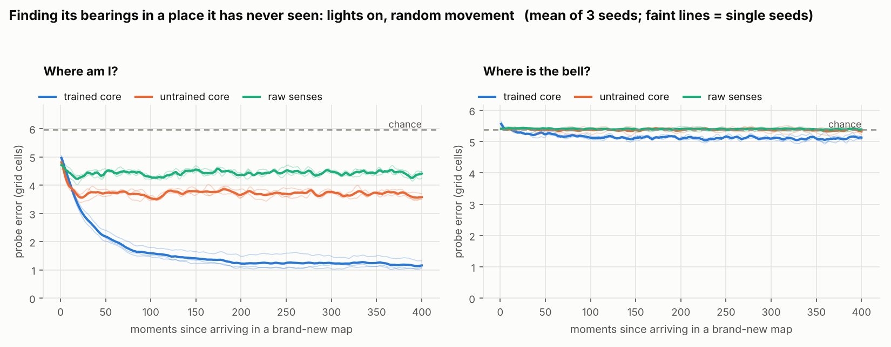
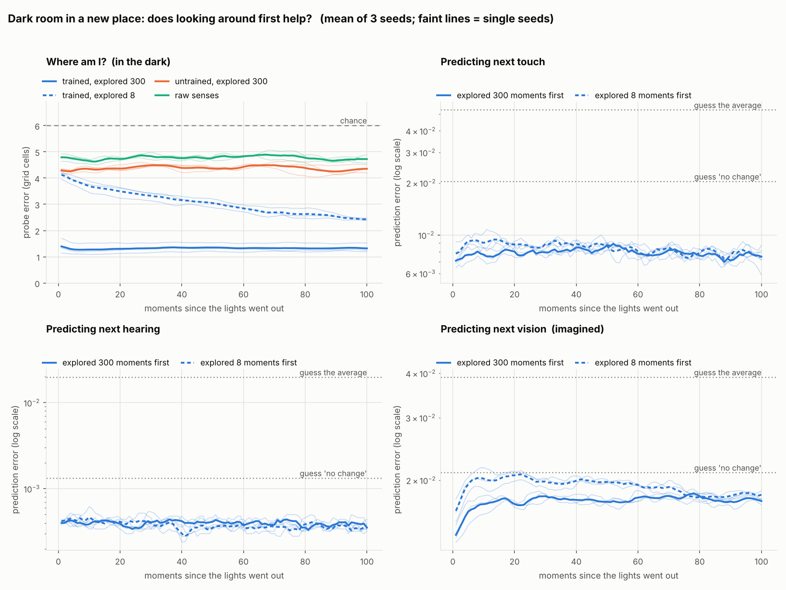
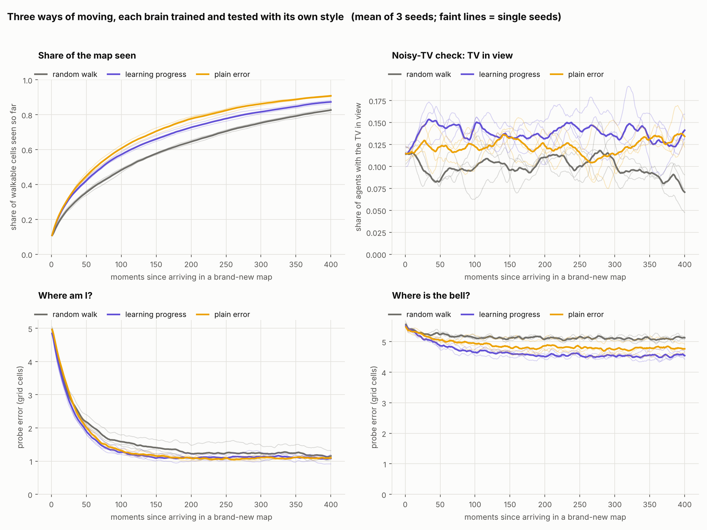
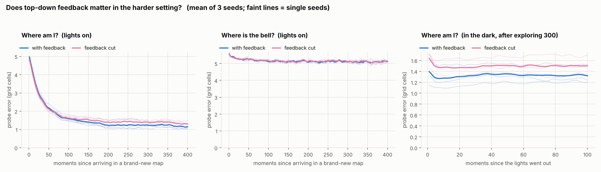

# BU-EAI — Bottom-Up Emergent AI

A working prototype of the BU-EAI thesis: instead of training a model top-down
on a static dataset, grow a mind from accumulated simulated experience.

An agent wanders a small 2D world with three senses. Its brain is built from
separate sensory regions that feed a shared recurrent core, and the core feeds
back into the regions. It has **no language, no reward, no labels and no
goal**. The only thing it ever learns is to predict what it will sense next.

Afterwards we freeze it and ask: did it work out things nobody told it, such
as where it is?

| Version | Question | Short answer |
|---|---|---|
| **v0.2** (current) | Dropped into a place it has never seen, does it build a map within one life? | It finds **where it is**: error falls from 4.55 to 1.19 cells in 400 moments, against 3.68 untrained and 4.43 for the raw senses. It does **not** yet remember **what is where**. |
| v0.1 (tag `v0.1`) | In one fixed world, does a sense of position emerge from prediction alone? | Yes: 0.40 cells in the dark, against 1.35 untrained and 2.42 raw senses. But that map was memorised in the weights. |

All numbers, tables, the things that did not work, and the reasoning behind
each choice are in **[RESULTS.md](RESULTS.md)**.

## Run it

```bash
pip install -r requirements.txt
```

The v0.2 experiment (12 brains: 4 conditions x 3 seeds; about 90 minutes on 4
CPU cores):

```bash
python run_v02.py
```

If it gets interrupted, this carries on where it stopped and gives the same
result as an uninterrupted run:

```bash
python run_v02.py --resume
```

A 2-minute smoke test (its numbers mean nothing):

```bash
python run_v02.py --quick
```

Reprint the report and redraw the plots from saved runs:

```bash
python run_v02.py --report-only
```

The noisy-TV follow-up (needs the brains saved by a finished `run_v02.py`):

```bash
python tv_check.py
```

The v0.1 experiment is unchanged and still gives its original numbers (2.5
minutes):

```bash
python run_experiment.py
```

Unit tests for the building blocks:

```bash
python -m pytest tests/ -q
```

Everything is deterministic: the same seeds give the same numbers. Outputs go
to `results/v0.2/` and `results/v0.1/`.

## The files

| File | What it is | Brain analogy |
|---|---|---|
| `bueai/world.py` | v0.1 grid world: map, objects, movement, ground truth | The outside world. Not part of the brain. |
| `bueai/many_worlds.py` | v0.2: random map generator, one map per agent, the noisy TV | Many different places to grow up in |
| `bueai/senses.py` | `Vision`, `Touch`, `Hearing` | Sense organs: eye, skin, ear |
| `bueai/model.py` | `SensoryRegion`, `VisionRegion`, `Brain`, curiosity heads | Sensory cortex areas, association area, top-down pathways, self-monitoring |
| `bueai/training.py` | `Life` (the loop of experience, movement styles, rebirth) and `train()` | Living, and learning from surprise |
| `bueai/newmap_test.py` | v0.2 tests: probes and dark room in never-seen maps | A neuroscientist recording from an animal in a new maze |
| `bueai/emergence_test.py`, `bueai/darkroom_test.py` | v0.1 tests | Recording from the brain; a blindfold experiment |
| `bueai/plots.py`, `bueai/plots_v02.py` | The figures | |
| `run_v02.py` | Runs the v0.2 experiment | |
| `tv_check.py` | Takes the noisy-TV result apart | |
| `run_experiment.py` | Runs the v0.1 experiment | |
| `tests/` | Unit tests (21) | |

## The world

v0.2 generates a new 16x16 map for every life. One example:

```
################        #  wall       grey,   feels rough,  silent
#mT#.......#####        .  floor      dark
#..#.........#m#        B  bell       red,    feels smooth, high pitch, loud,   solid
#............#.#        F  fountain   blue,   feels wet,    mid pitch,  medium, solid
#............#.#        m  moss       green,  feels soft,   low pitch,  quiet,  walkable
#......##....#.#        T  noisy TV   random colour every moment, feels glassy, silent, solid
#..........F...#
#..............#
#.m.######.....#
#.......##.....#
##....B.##.....#
##......##.....#
##.......#.....#
##.............#
##.............#
################
```

Every map has 1 bell, 1 fountain, 3 moss patches and 1 TV. Every map is fully
connected, has no mirror or rotation symmetry, and no two walkable cells give
identical sensations, so "where am I?" always has an answer. v0.1 used one
fixed 12x12 map without the TV.

The senses:

- **Vision**: a 5x5 patch of RGB colours centred on the agent (75 numbers).
- **Touch**: the texture under the agent and on its four sides.
- **Hearing**: loudness of each of the 3 pitches, fading with distance. No direction.

Actions are stay / north / east / south / west.

The **noisy TV** is there to test curiosity. Its colour is pure chance, so it
can never be predicted. An agent that simply seeks out what it predicts badly
could stare at it forever.

## The brain

```
               +-----------------------------------------+
               |      top-down feedback (previous state) |
               v                                         |
vision  --> [vision region ] --+                         |
touch   --> [touch region  ] --+--> [ recurrent core ] --+--> [predictors] --> next vision
hearing --> [hearing region] --+        ^     |   |                        --> next touch
                                        |     |   +-- + action ------------^   next hearing
                          last action --+     |
                                              +--> [curiosity heads]  (v0.2; read-only)
```

One moment of experience, as coded in `Life.live()`:

1. **Sense.** Each sense organ reports its numbers.
2. **Update the mind.** Each sensory region encodes its own sense, together with the core's previous state (the top-down feedback). The core, a GRU, combines the three encodings with its own memory and the last action taken.
3. **Act.** A random move, possibly tilted by curiosity (v0.2).
4. **Predict.** From the core state and the chosen action, one predictor per sense guesses the next sensation.
5. **Compare.** The world moves; the squared difference between guess and reality is the prediction error.

`train()` lowers that error by gradient descent. That is the entire learning
signal. `world.ground_truth()` (true position and so on) is only ever read by
the tests.

### What v0.2 adds

- **Many lives.** A life lasts 512 moments. Then the agent is reborn in a
  brand-new map with a blank core state. The weights carry over; the contents
  of the mind do not. Over training each brain passes through about 48,000
  maps, so no single map can be memorised in the weights.
- **A bigger core** (256 units) and four times as much experience (192,000
  moments per agent).
- **Curiosity heads.** Two small networks read the core and guess the brain's
  own prediction error: on a first look, and on an immediate second look at the
  same place. They cannot change the core or the predictors; they only watch.
- **Three movement styles**, identical except for one multiplier on the random
  walk:
  - *random walk*, as in v0.1
  - *learning progress*: prefer actions where the first-look error is expected
    to be high and the second-look error low (surprising now, learnable soon)
  - *plain error*: prefer actions where the first-look error is expected to be
    high (the naive version that should fall for the TV)

### What "position" means when every map is different

Position is (x, y) inside the arena, whose outer wall is the same size in every
map. It is knowable, but not at a glance: the agent has to find walls and keep
count of its own steps. One linear probe is shared by all maps, fitted on one
set of new maps and scored on a different set, so it cannot memorise a map.

A second probe asks **where the bell is**. That differs in every map, so the
weights cannot know it. If the core holds it, the brain has stored a fact about
this particular place.

## v0.2 results in brief

Full tables are in [RESULTS.md](RESULTS.md). Seeds 0, 1, 2.

### It finds its bearings in a place it has never seen



On arrival the trained brain is as lost as the baselines. Within about 50
moments its position error halves, and it settles near 1.2 cells. The same
network untrained stays at 3.7 and the raw senses at 4.4, because neither can
accumulate anything. None of the test maps appeared in training.

It does **not** learn where the bell is (right panel): 5.10 cells against 5.37
for chance.

### The position sense survives the dark



After 300 moments of looking around, the brain keeps its position to 1.33
cells through 100 dark moments. Agents that saw almost nothing first (dashed)
still improve while blind, using touch and hearing alone. But having looked
around makes dark *predictions* only 6 to 9% better, which again says the
layout itself is not being stored.

### Curiosity explores faster, and nobody got stuck at the TV



Both curious styles see more of the map and get their bearings sooner. The
planned demonstration, plain-error curiosity stuck at the TV while learning
progress walks away, **did not happen**: neither style gets stuck.
`tv_check.py` shows the learning-progress signal does ignore the TV noise that
the plain-error signal reacts to, but the agent never stays at the TV, mainly
because the rest of the map never becomes boring to a brain that does not
remember it.

### Top-down feedback: still not shown



A small edge late in life, in 2 of 3 seeds. Not enough to claim.

## What these results do not show

- **It locates itself; it does not store the place.** The thesis needs both.
- **The agent is told when the place changes**, by the blank core state at each
  new life.
- **Finding position may be a learned routine** (find walls, count steps) held
  in the weights. What is built within a life is the estimate.
- **The noisy-TV comparison is untested**, not passed: this world had no trap
  to fall into.
- **Three seeds.** Enough for the big effects, not for the small ones.

## Plan for v0.3

1. **Continuous life with unannounced moves.** One unbroken life. At
   unpredictable moments the agent is placed in a different map, with no reset
   and no signal. It has to notice from its own prediction errors that the
   place has changed, drop its old estimate and rebuild. Measure how long
   noticing and recovering take.
2. **Get "what is where" to emerge**: make remembering pay (3x3 view, longer
   blackouts, more return visits), and give the core a memory it can write to
   and look things up in.
3. **A fair noisy-TV test** once 2 works: a bigger TV, longer lives, curiosity
   that looks several steps ahead.
4. **Give feedback a job**: ambiguous senses, more seeds.

Details and reasons are at the end of the v0.2 entry in
[RESULTS.md](RESULTS.md).

## Moving to 3D later

The brain never mentions "grid", "vision" or any specific sense. It is built
from `world.sense_shapes`, a dictionary of names and shapes, and loops over
whatever is in it. To move to MiniWorld or MuJoCo:

1. **Write a new world class** with the same members as `GridWorld`:
   `sense_shapes`, `n_actions`, `reset(n_agents, seed)`, `step(actions)`,
   `ground_truth()`. `reset` and `step` return a dict of NumPy arrays with one
   row per agent. For many-worlds training also provide `new_life(agents)`,
   which gives those agents a new place and returns their first sensations
   (see `ManyWorlds`).
2. **Swap the vision region** for a deeper CNN. Any module with
   `forward(image, core_state)` returning `(batch, latent_size)` and a
   `latent_size` attribute works:

   ```python
   brain = Brain(world.sense_shapes, world.n_actions,
                 regions={"vision": MyBiggerCNN(...)})
   ```

`Life` and `train()` then run unchanged. The v0.2 tests build a `ManyWorlds`
themselves and read its ground truth (position, bell, share of map seen), so
they need a small edit to take the new world instead. `tests/test_sanity.py`
has a test that builds a brain with a 9x9 image and a made-up "smell" sense to
confirm no brain code needs to change.

Two things will need real work in 3D: continuous actions (the predictors take
a one-hot action today), and predicting raw pixels with squared error, which
gets blurry. Predicting in the region's latent space is the usual fix.
