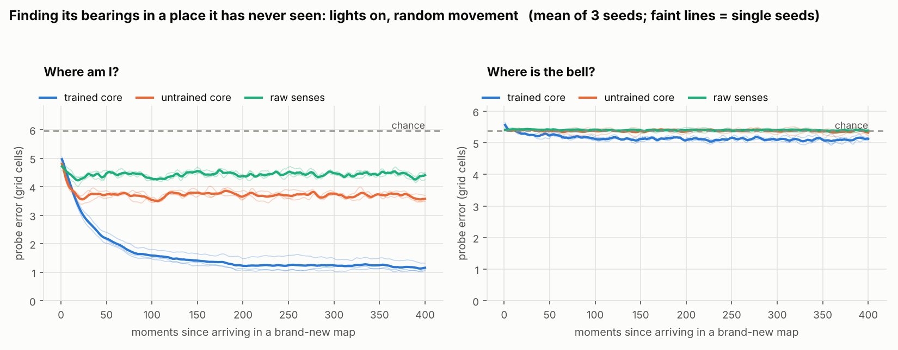
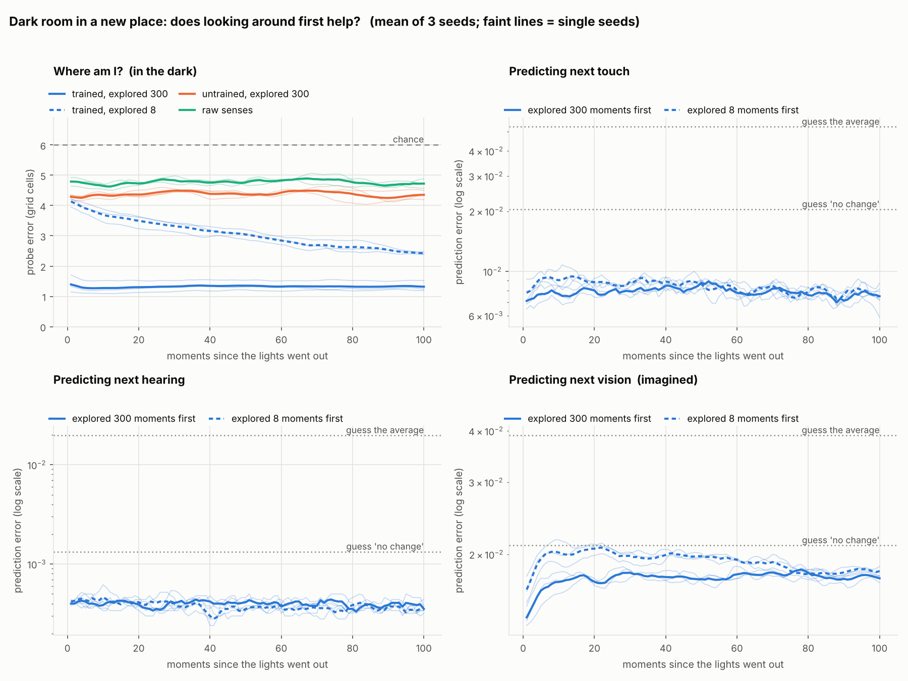
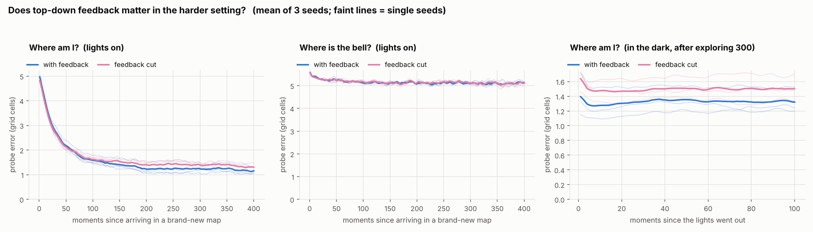
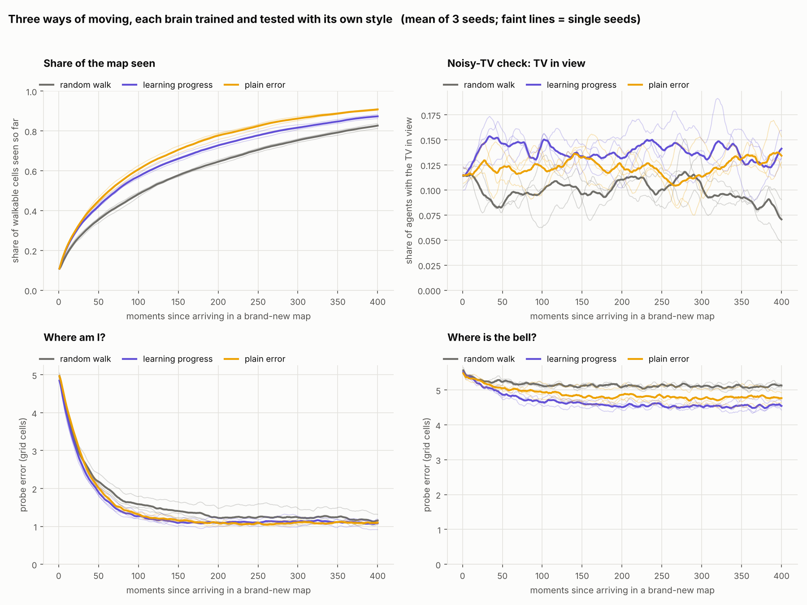
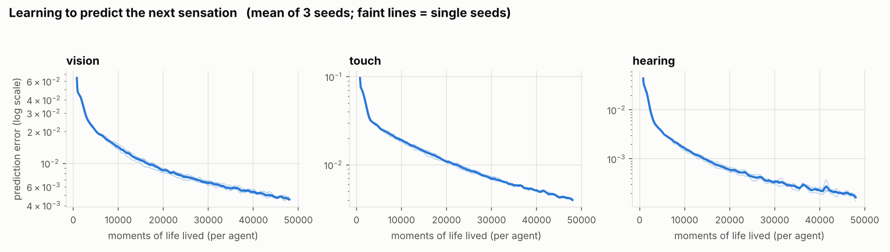
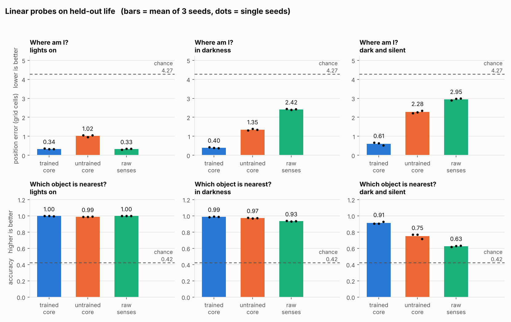
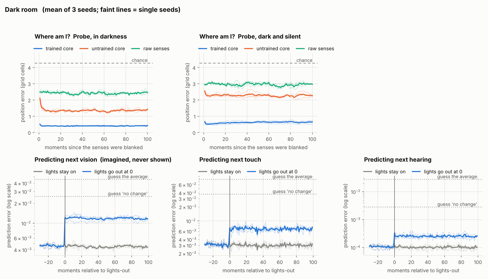

# BU-EAI results log

One entry per version, newest first. Every number here was produced by the
code in this repository with fixed seeds, and each cell is the mean followed by
the value from each seed `[seed 0, seed 1, seed 2]`.

- [v0.2: many worlds](#v02--many-worlds-2026-11-11)
- [v0.1: one fixed world](#v01--one-fixed-world)

---

## v0.2 — many worlds (2026-11-11)

**Goal:** the brain should build a map of a *new* place within its lifetime,
instead of memorising one fixed map in its weights.

Reproduce with `python run_v02.py` (about 90 minutes on 4 CPU cores), then
`python tv_check.py`. Raw output: `results/v0.2/report.txt`,
`results/v0.2/tv_check.txt`, `results/v0.2/runs/*.json`.

### Verdict

| Question | Answer | Evidence |
|---|---|---|
| Does it work out **where it is** in a place it has never seen? | **Yes, clearly.** | Position error falls from 4.55 to 1.19 cells over 400 moments. Untrained network: 3.68. Raw senses: 4.43. 3 of 3 seeds. |
| Does that survive the lights going out? | **Yes.** | 1.33 cells in the dark after exploring, against 4.38 untrained and 4.77 raw senses. |
| Does it remember **what is where** in the new place? | **Barely.** | "Where is the bell?" is 5.10 cells against 5.37 for chance. Dark predictions are only 6 to 9% better after a long look around. |
| Does top-down feedback matter in the harder setting? | **Not shown.** | Small edge late in life, in 2 of 3 seeds only. |
| Does curiosity help? | **Yes, for exploring.** | Both curious styles see the map faster and get their bearings sooner. |
| Does plain-error curiosity get stuck on the noisy TV? | **No. The demonstration we planned did not work.** | Neither style gets stuck. The reason is measured below. |

The honest one-line summary: **the brain learned to find itself in new places,
but not to remember them.** It builds a "you are here" dot, not yet a map with
things on it.

### What changed from v0.1

| | v0.1 | v0.2 |
|---|---|---|
| World | one fixed 12x12 map | a new random 16x16 map for every life |
| Life | one continuous life | lives of 512 moments; each new life is a new map and a blank core state |
| Objects | bell, fountain, moss | the same, plus one **noisy TV** per map |
| Movement | random walk | random walk, learning-progress curiosity, plain-error curiosity |
| Core | 128 units | 256 units |
| Experience per agent | 48,000 moments | 192,000 moments, across about 48,000 maps per brain |
| Main test | probes on the one known map | probes on never-seen maps, against time since arrival |

Each map has 1 bell, 1 fountain, 3 moss patches and 1 TV, is fully connected,
has no mirror or rotation symmetry, and no two walkable cells in it give
identical sensations. The TV shows a fresh random colour every moment, is
silent, and feels "glassy".

### Choices I made, and why

**What "position" means.** Position is (x, y) measured inside the arena, whose
outer wall is the same size in every map. That makes position *knowable* but
not *visible*: the agent has to find walls and keep count of its own steps from
there. **One** linear probe is shared by all maps. It is fitted on one set of
new maps and scored on a different set, so it cannot memorise any map. It can
only work if the brain uses the same code for position everywhere.

A second probe asks **"where is the bell?"** Position can be worked out by a
general skill stored in the weights (wall-finding plus step-counting). The
bell's location cannot: it is different in every map. So this probe is the
direct test of whether the core holds a fact about *this particular place*.

**Making position hard to see.** I enlarged the map to 16x16 and kept the 5x5
view. I checked this was enough before training anything: on new maps the raw
senses give 4.4 cells of error (chance about 6.0), against 0.33 in v0.1. One
glance no longer tells you where you are. A 3x3 view was not needed.

**Brain size and lifetime.** These come from a pilot on one seed:

| Setting | Choice | Why |
|---|---|---|
| Core size | 256 | 384 was slightly better per update but slower; not better per minute |
| Parallel agents | 128 | 256 gave no gain per update and ran 1.7x slower |
| Learning window | 32 moments | 64 and 128 gave no gain |
| Updates | 6,000 | Position error in new maps was 1.50 at 3,000 updates and 1.08 at 6,000 |
| Learning rate | 0.001, gliding to 0.0003 over the second half | 0.002 was worse (1.65 to 1.73 at 3,000 updates) |
| Life length | 512 moments | A random walker sees about 83% of a map in 400 moments |

Training took 27.5 minutes per brain for random movement and 31 minutes for
the curious styles. Twelve brains (4 conditions x 3 seeds), four at a time,
came to about 90 minutes.

**Blank mind per life.** At each rebirth the core state is zeroed, so the agent
is told, in effect, "this is a new place". That is a simplification. The v0.3
plan removes it (see the end of this entry).

**Curiosity method.** The noisy-TV problem is that anything random is always
badly predicted, so a curiosity that seeks prediction error stares at it
forever. I chose **expected learning progress**:

- Two small extra networks read the core (without being able to change it).
  One guesses "how wrong will my prediction be if I do this?" (first look). The
  other guesses "how wrong would I be on an immediate second look at the same
  place?" (second look). The second one learns from moments where the agent
  happened to stay put.
- The curiosity score for an action is first look minus second look. A new
  corner is surprising once and then known: big score. TV static is as
  surprising the second time: the two cancel.
- The agent's walk is the same random walk as before, with each action's chance
  multiplied by exp(3 x score). With the multiplier off it is exactly the
  random walk, so the movement styles differ in nothing else.

I rejected the common alternative, disagreement between several copies of the
model. Disagreement measures what the *weights* have not learned yet. In this
project the unexplored part of a random map is unknowable to the weights
forever, exactly like TV static, so disagreement could not tell the two apart.

**Plain-error curiosity** uses the first-look guess alone as the score. It was
added as the method that *should* fall for the TV.

### Test 1: finding its bearings in a never-seen map

256 agents, each dropped into its own new map, lights on, random movement.
None of the 1,536 test maps per condition had appeared in training (checked by
fingerprint). Error in grid cells, lower is better.

**Where am I?**

| Probe reads | Moments 1-10 | 40-60 | 90-110 | 190-210 | 350-400 |
|---|---|---|---|---|---|
| **trained core** | 4.55 | 2.18 | 1.59 | 1.23 | **1.19** [1.07 1.41 1.07] |
| untrained core | 4.33 | 3.73 | 3.56 | 3.72 | 3.68 [3.60 3.71 3.72] |
| raw senses | 4.57 | 4.44 | 4.29 | 4.40 | 4.43 [4.39 4.46 4.44] |
| chance | 5.39 | 6.01 | 5.88 | 6.08 | 6.02 |

- On arrival the trained brain is as lost as everything else (4.55). Nothing
  about the place is in its weights.
- Its error then halves within about 50 moments and reaches about 1.2 cells by
  moment 200. The untrained network and the raw senses stay flat, because they
  cannot accumulate anything.
- This is the result v0.1 could not give: the position sense is built **during
  the life**, in a place the weights have never seen.

**Where is the bell?**

| Probe reads | Moments 1-10 | 40-60 | 90-110 | 190-210 | 350-400 |
|---|---|---|---|---|---|
| trained core | 5.44 | 5.26 | 5.13 | 5.12 | 5.10 [5.19 5.02 5.10] |
| untrained core | 5.39 | 5.37 | 5.37 | 5.37 | 5.36 |
| raw senses | 5.41 | 5.41 | 5.40 | 5.40 | 5.39 |
| chance | 5.37 | 5.37 | 5.37 | 5.37 | 5.37 |

The trained core is better than chance in all 3 seeds, but only by 5%. For
practical purposes the core does **not** hold where the bell is. (A linear
probe might miss a memory stored in some more tangled form, but the dark-room
predictions below point the same way.)

### Test 2: dark room in a new place

The agent explores a new map with the lights on for either 8 moments (almost
nothing) or 300 moments, then vision is blanked for 100 moments.

| Where am I, in the dark? (chance 6.01) | Position error |
|---|---|
| **trained core, explored 300** | **1.33** [1.26 1.53 1.19] |
| trained core, explored 8 | 3.06 [3.06 3.20 2.92] |
| untrained core, explored 300 | 4.38 |
| raw senses, explored 300 | 4.77 |

| Prediction error in the dark | Explored 8 | Explored 300 | Guess "no change" | Guess the average |
|---|---|---|---|---|
| touch | 0.0084 | 0.0079 | 0.0204 | 0.0529 |
| hearing | 0.0004 | 0.0004 | 0.0013 | 0.0198 |
| vision (imagined) | 0.0192 | 0.0175 | 0.0210 | 0.0390 |

- **Position holds in the dark.** After 300 moments of looking around, the
  brain keeps its position to 1.33 cells for 100 dark moments with no drift.
- **It can localise by touch and hearing alone.** The agents that saw only 8
  moments start the dark period lost (about 4.1) and still improve to about 2.4
  while blind (dashed line, top-left panel). Vision makes it faster, not
  possible.
- **Looking around first helps prediction only a little.** Touch is 6% better
  and imagined vision 9% better after exploring; hearing is the same. If the
  brain had stored the layout, the gap would be large. Imagined vision is only
  modestly better than guessing "no change" (0.0175 against 0.0210).

### Test 3: does top-down feedback matter here?

Same seeds, same maps, same walks; feedback connections on or cut.

| Where am I? | Moments 40-60 | 90-110 | 190-210 | 350-400 | In the dark, after 300 |
|---|---|---|---|---|---|
| with feedback | 2.18 | 1.59 | 1.23 [1.06 1.52 1.11] | 1.19 [1.07 1.41 1.07] | 1.33 [1.26 1.53 1.19] |
| feedback cut | 2.12 | 1.62 | 1.39 [1.16 1.48 1.54] | 1.34 [1.18 1.35 1.49] | 1.50 [1.34 1.48 1.66] |

**Not shown.** The first 100 moments are identical. Later the feedback brain is
ahead by about 0.15 cells on average, but only in 2 of 3 seeds, and in seed 1
the order flips. Prediction error during training is indistinguishable, and
the bell probe is the same (5.10 against 5.09). The hint is in the right
direction and slightly larger than in v0.1, but three seeds cannot carry it.
The likely reason is unchanged: these senses are clean and unambiguous, so a
region gains little from being told the context.

### Test 4: three ways of moving

Each brain here was trained with one movement style and is tested with that
same style.

| | Random walk | Learning progress | Plain error |
|---|---|---|---|
| Share of map seen after 100 moments | 0.48 | 0.57 | 0.61 |
| Share of map seen after 400 moments | 0.83 | 0.87 | 0.91 |
| Position error, moments 90-110 | 1.59 [1.47 1.80 1.49] | 1.27 [1.19 1.23 1.38] | 1.31 [1.28 1.37 1.29] |
| Position error, moments 350-400 | 1.19 [1.07 1.41 1.07] | 1.10 [1.15 0.97 1.17] | 1.10 [1.10 1.13 1.07] |
| Bell error, moments 350-400 (chance 5.37) | 5.10 | 4.55 [4.46 4.72 4.45] | 4.80 [5.06 4.75 4.58] |
| Share of time with the TV in view | 0.099 | 0.138 | 0.123 |

- **Curiosity explores faster.** Both curious styles cover more of the map at
  every point, in all seeds.
- **Curious brains get their bearings sooner, not better.** At moment 100 they
  are ahead in 3 of 3 seeds. By moment 400 the three styles overlap.
- **Curious brains hold a little more about the bell** (4.55 for learning
  progress, 15% better than chance). Treat this with care: a curious agent may
  simply linger near objects, in which case its own position gives the bell
  away. This run cannot separate the two.
- **The curiosity only works for the brain that grew up with it.** Steering a
  random-walk-trained brain with its own curiosity scores (Test 4b in
  `report.txt`) made things worse: 72% of the map seen instead of 83%, and
  position error 1.83 instead of 1.19. That brain had never experienced that
  way of moving.
- Training losses are not comparable between styles. The curious brains show
  higher prediction error because they seek out the hard-to-predict moments.

### The noisy TV: what we planned to show, and what happened

The plan was to show plain-error curiosity stuck at the TV while learning
progress walks away. **That did not happen.** Plain error spent 12.3% of its
time with the TV in view, learning progress 13.8%, the random walk 9.9%.
Neither is stuck, and learning progress is slightly *higher*.

`tv_check.py` takes this apart (units: squared error x 100, summed over senses):

| | Random walk | Plain error | Learning progress |
|---|---|---|---|
| Real error, TV in view | 2.28 | 2.79 | 2.57 |
| Real error, no TV | 0.56 | 0.74 | 0.72 |
| ...no TV, moments 1-50 | 0.59 | 0.75 | 0.71 |
| ...no TV, moments 200-400 | 0.55 | 0.73 | 0.72 |
| Error score (first look), TV in view | 1.19 | 1.42 | 1.46 |
| Error score (first look), no TV | 0.75 | 0.73 | 0.73 |
| Second-look guess, TV in view | 0.61 | 1.17 | 1.17 |
| Second-look guess, no TV | 0.32 | 0.49 | 0.45 |
| Progress score, TV in view | 0.64 | 0.38 | 0.39 |
| Progress score, no TV | 0.46 | 0.27 | 0.31 |
| TV stays in view next moment | 0.904 | 0.889 | 0.916 |
| TV comes into view | 0.010 | 0.015 | 0.013 |

Reading it in three steps:

1. **The TV is a real trap in the world.** Prediction error is about 4 times
   higher when the TV is in the picture.
2. **The scores behave as designed.** With the TV in view the plain-error
   score doubles (0.73 to 1.42). The second-look head has learned that the TV
   stays unpredictable (0.49 to 1.17), so the learning-progress score rises
   much less (0.31 to 0.39). The cancelling trick works on the signal.
3. **The behaviour does not follow.** Once the TV is in view, the plain-error
   agent keeps it in view 88.9% of the time, which is *less* than the random
   walk (90.4%). It does not hold on to the TV. Curious agents see the TV more
   only because they cover more ground and so run into it more often (0.015
   and 0.013 against 0.010 per moment).

Why the trap never closes, as far as this data shows:

- **The rest of the world never gets boring.** A noisy TV traps an agent when
  everything else has become predictable. Here, error on ordinary scenery is
  the same late in a life as at the start (0.75 then 0.73 for the plain-error
  brain). Because the brain does not remember what is where, every step into
  scenery is fresh surprise, and moving stays as attractive as the TV. **The
  missing TV trap and the weak bell memory are the same finding.**
- **The TV is small.** It is 1 of the 25 cells in view, and it only pays while
  the agent is within 2 cells.
- **The curiosity looks one step ahead.** Staying next to a TV for a long time
  takes a plan ("hover here"). A one-step score cannot express that.

So the claim I can support is narrow: the learning-progress *signal* ignores
TV noise that the plain-error signal responds to. The claim "learning progress
avoids a trap that plain error falls into" is **untested**, because in this
world there was no trap to fall into.

### What v0.2 does not show

- **No stored map of contents.** Self-location is solid; landmark memory is
  marginal. The thesis needs both.
- **The agent is told when the place changes** (blank core state at each new
  life). Noticing a move without being told is untested.
- **Position may be a learned routine, not a "map".** Finding walls and
  counting steps is a general skill that lives in the weights. What is built
  within a life is the *estimate*, which is real but more modest than "a map of
  the place".
- **The curiosity comparison mixes two things**: each curious brain differs
  from the random one in both its training experience and its test movement.
- **Three seeds.** Enough for the large effects (position), not for the small
  ones (feedback, final position error between styles).

### Checks

- 21 unit tests pass (`python -m pytest tests/ -q`), including: the fast batched
  senses match the readable v0.1 ones exactly; every map is different; the TV
  is the only thing that flickers; curiosity strength 0 equals the random walk;
  the curiosity networks send no gradient into the world model.
- Runs are deterministic. A run that is interrupted and resumed gives
  bit-identical weights to one that is not.
- v0.1 still reproduces its committed numbers exactly after the v0.2 changes.

### Plan for v0.3

1. **Continuous life with unannounced moves** (decided). One unbroken life. At
   unpredictable moments the agent is placed in a different map with no reset
   and no signal. It has to notice from its own prediction errors that the
   place has changed, drop the old estimate and rebuild. Measure how long it
   takes to notice and to recover.
2. **Get "what is where" to emerge.** This is the main gap. Things to try, in
   the order I would try them:
   - Make remembering pay: a 3x3 view and longer blackouts, so that predicting
     well requires recalling what was seen earlier.
   - Longer lives with more return visits to the same spot.
   - A memory the core can write to and look things up in (store "core state,
     what I sensed" pairs; recall the nearest ones). That is roughly the job
     the hippocampus does next to the cortex. A longer learning window alone
     did not help in the pilot.
3. **A fair noisy-TV test**, after 2. A bigger TV (several cells, or one that
   lights up its surroundings), longer lives, and curiosity that values
   surprise several steps ahead. Only once the rest of the map can become
   boring is there a trap for plain error to fall into.
4. **Give feedback a job**: noisy or ambiguous senses (two objects that look
   the same and sound different), then repeat the feedback comparison with
   more seeds.
5. **Separate the curiosity confound**: test every brain under every movement
   style, and report the bell probe with the agent's distance to the bell
   controlled.

---

## v0.1 — one fixed world

One fixed 12x12 map, one continuous life of 48,000 moments per agent (64
agents), random movement, 128-unit core. Reproduce with
`python run_experiment.py` (2.5 minutes on 4 cores). Raw numbers:
`results/v0.1/results.json`.

### Verdict

**Position emerged; most other things tested did not show emergence.** With
vision off, a linear read-out of the trained core finds the agent to 0.40
cells, against 1.35 for the untrained network and 2.42 for the raw senses, in
3 of 3 seeds.

### Prediction got better

| Sense | Error at start of life | Error at end |
|---|---|---|
| vision | 0.0536 | 0.0046 |
| touch | 0.0796 | 0.0041 |
| hearing | 0.0330 | 0.0002 |

### Emergence test: where am I?

Position error in grid cells. The probe is fitted on one stretch of life and
scored on a separate one.

| Probe reads | Lights on | In darkness | Dark and silent |
|---|---|---|---|
| **trained core** | 0.34 [0.36 0.33 0.32] | **0.40** [0.42 0.39 0.38] | **0.61** [0.67 0.64 0.52] |
| untrained core | 1.02 [1.05 0.95 1.05] | 1.35 [1.31 1.39 1.35] | 2.28 [2.22 2.26 2.35] |
| raw senses | 0.33 [0.30 0.34 0.35] | 2.42 [2.44 2.39 2.43] | 2.95 [2.89 2.97 2.99] |
| chance | 4.27 | 4.27 | 4.27 |

- **Lights on shows nothing.** The raw senses do as well as the trained core
  (0.33 against 0.34): in a small world a 5x5 view is nearly a fingerprint of
  the cell. (v0.2 fixes this.)
- **Darkness is where it shows.** The trained core stays at 0.40 while the
  baselines fall to 1.35 and 2.42.
- **Dark and silent** (touch only): still 0.61, and flat over 100 steps. The
  brain is adding up its own movements on a remembered layout.

### Emergence test: which object is nearest?

| Probe reads | Lights on | In darkness | Dark and silent |
|---|---|---|---|
| trained core | 1.00 | 0.99 | **0.91** [0.91 0.91 0.93] |
| untrained core | 0.99 | 0.97 | 0.75 [0.77 0.77 0.72] |
| raw senses | 1.00 | 0.93 | 0.63 [0.62 0.63 0.63] |
| chance | 0.42 | 0.42 | 0.42 |

Mostly uninformative: while hearing works, loudness gives the answer away.

### Dark-room test

| Predicting | Lights on | Lights out | Guess "no change" | Guess the average |
|---|---|---|---|---|
| touch | 0.0030 | 0.0068 | 0.0377 | 0.0785 |
| hearing | 0.0001 | 0.0003 | 0.0029 | 0.0279 |
| vision (imagined) | 0.0045 | 0.0119 | 0.0254 | 0.0458 |

Predictions get 2 to 3 times worse when the lights go out, then stay flat, and
remain far better than guessing "no change".

### Top-down feedback

| Position error | Lights on | In darkness | Dark and silent |
|---|---|---|---|
| with feedback | 0.34 | 0.40 [0.42 0.39 0.38] | 0.61 |
| feedback cut | 0.36 | 0.46 [0.48 0.49 0.42] | 0.63 |

Hardly any difference at this scale.

### What v0.1 does not show

- **The map is in the weights.** One fixed world, memorised over 48,000
  moments. Nothing here says how fast a new place could be learned. (This is
  what v0.2 set out to test.)
- **The agent practised being blind**: vision and hearing each switch off about
  a quarter of the time in training.
- **Untrained networks are a strong baseline** (1.02 cells with the lights on).
- A linear probe finding position shows the information is present, not that
  the brain "uses" it.
- Three seeds on one map.

### Decisions made in v0.1

| Topic | Decision | Why |
|---|---|---|
| One world or many | One fixed map | "Absolute position" needs a fixed world |
| Episodes | None: one continuous life, learning online, no replay | Closest to "accumulated experience" |
| Parallel lives | 64 copies of the agent at once | CPU speed only |
| Heading | None; vision is centred on the agent but never rotated | Keeps v0.1 small |
| Motor copy | The core is told the last action it took | Without it the brain cannot track its own movement. Brains do this too ("efference copy"). |
| Blackouts in training | Vision and hearing each go off ~25% of the time | Otherwise the dark-room test measures confusion at a never-seen input |
| Movement | Random with momentum | Pure coin-flips barely leave the starting area |
| Loss | Mean squared error for all senses | One uniform meaning of "prediction error" |
| Untrained baseline | An exact copy of the same network before training | The fairest "same network untrained" |
